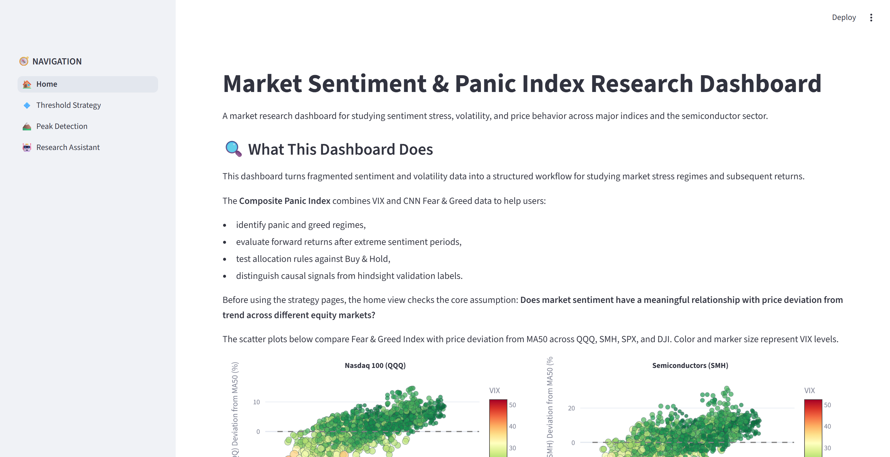
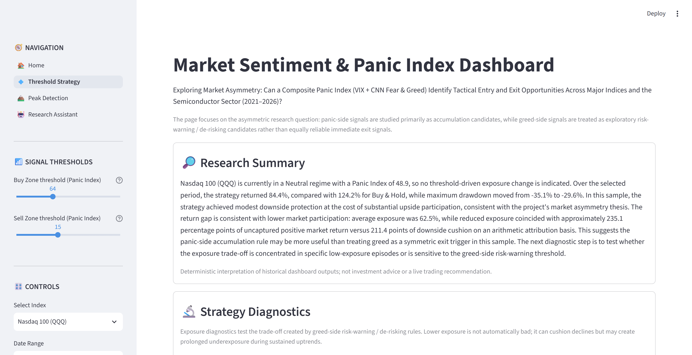
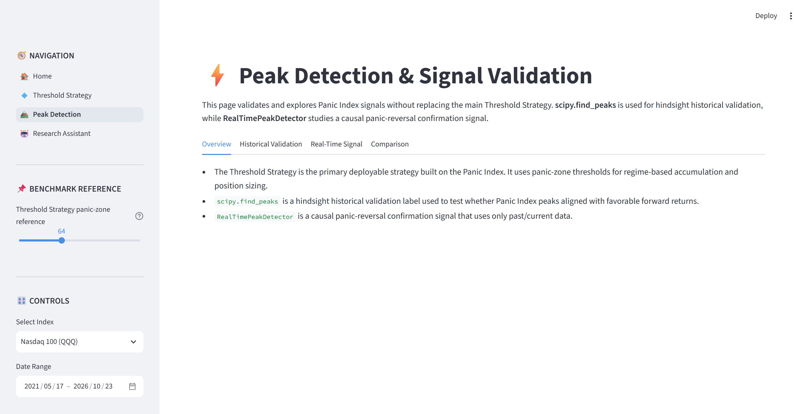

# Market Sentiment & Panic Index Dashboard

Repository: `Yiting0210/panic-index-dashboard`

> **Exploring Market Asymmetry**: Can a Composite Panic Index (VIX + CNN Fear & Greed) identify tactical entry and exit opportunities across major indices and the Semiconductor sector (2021-2026)?

**Live Demo**: https://panic-index-dashboard-rpbcjhdyxbvfcbk39h6gbw.streamlit.app/

---

## Overview

This Streamlit dashboard studies whether extreme sentiment regimes contain **asymmetric tactical information** across QQQ, SMH, SPX, and DJI.

The project is built around a **Composite Panic Index**, combining VIX and CNN Fear & Greed data. The research thesis is intentionally asymmetric:

- **Panic-side extremes** are studied primarily as accumulation / tactical entry regimes.
- **Greed-side extremes** are evaluated more cautiously because optimistic sentiment can persist during sustained bull markets.
- Greed-side signals are therefore treated as risk-warning / de-risking candidates, not as equally reliable symmetric opposites of panic-side accumulation signals.

The dashboard separates threshold strategy research, exposure diagnostics, forward-return analysis, hindsight peak validation, and causal panic-reversal confirmation.

**Key Finding**: In this historical sample, extreme panic regimes were more consistently associated with favorable medium-term forward returns, while extreme greed was less reliable as an immediate exit signal during sustained bull markets. This is historical regime evidence, not guaranteed alpha.

---

## Screenshots

### Home Page



### Threshold Strategy



### Peak Detection & Signal Validation



---

## Features

- **Threshold Strategy**: causal, backtestable research framework using Panic Index threshold regimes.
- **Deterministic Research Summary**: rule-based interpretation of current regime, backtest results, exposure diagnostics, and attribution outputs without using an LLM API.
- **Strategy Diagnostics**: Average Exposure and Time Below Full Exposure to explain participation versus Buy & Hold.
- **Exposure Trade-off Attribution**: separates arithmetic upside drag from downside cushion using lagged effective exposure consistent with backtest timing.
- **Backtest Performance**: total return, maximum drawdown, Sharpe Ratio, and Calmar Ratio using canonical project metric calculations.
- **Forward Return Analysis**: historical return distributions and summaries after panic and greed observations.
- **scipy.find_peaks Historical Validation**: hindsight labels used to evaluate whether Panic Index peaks historically aligned with favorable forward returns.
- **RealTimePeakDetector Causal Signal Analysis**: past/current-data-only panic-reversal confirmation signal for tactical research.
- **Interactive Controls**: market selector, date range, thresholds, position sizing, horizons, and peak-detection parameters.
- **MCP Research Server**: regime, backtest, forward-return, peak-detection, and FOMC-search tools for any MCP client, each pinned to an `as_of` date.
- **RAG over FOMC Documents**: hybrid dense + BM25 retrieval over 137 FOMC statements, minutes, and Chair press conference transcripts, filtered by public release date.
- **Research Assistant**: tool-use client for Claude or DeepSeek with bring-your-own API keys, citations, cost and latency logging, a daily budget for the app's key, and a rule-based fallback.
- **Evaluation Suite**: retrieval recall@5 / MRR, look-ahead leakage tests, and agent tool-selection / faithfulness metrics in CI.
- **Daily Data Updates**: scheduled, append-only ingestion of prices, Fear & Greed, and FOMC documents with data-quality checks.

---

## Product Case Study

### Target Users

- **ETF investors** who want a structured way to study extreme sentiment regimes without relying on a single indicator.
- **Market research analysts** comparing sentiment conditions with subsequent market behavior.
- **Risk-aware portfolio builders** evaluating accumulation rules, exposure changes, and drawdown tradeoffs.
- **Quantitative researchers** comparing hindsight validation methods with causal signal-generation logic.

### User Problem

Market sentiment data is fragmented and easy to overinterpret. VIX captures expected volatility, while CNN Fear & Greed represents a broader sentiment regime; neither indicator alone provides a complete decision framework.

The product problem is to separate regime identification from short-term prediction, causal/backtestable rules from hindsight validation, and historical relationships from guaranteed trading performance.

### Product Solution

The dashboard turns VIX and CNN Fear & Greed data into a Composite Panic Index and presents it through two research workflows:

- **Threshold Strategy**: a causal, backtestable allocation research workflow based on Panic Index regimes, exposure behavior, performance metrics, diagnostics, and deterministic interpretation.
- **Peak Detection & Signal Validation**: a research workflow for hindsight historical validation and causal panic-reversal signal analysis.

The dashboard intentionally separates **performance measurement**, **behavioral diagnostics**, **attribution**, and **interpretation**. This makes the research workflow more explainable, auditable, and safer to review.

### Key Workflows

1. Observe the current Panic Index regime.
2. Evaluate threshold-based exposure behavior.
3. Compare strategy performance with Buy & Hold.
4. Diagnose average exposure and time below full exposure.
5. Inspect the trade-off between uncaptured upside and downside cushion.
6. Interpret the results through a deterministic Research Summary.
7. Compare hindsight peak labels with causal confirmation signals on the validation page.

This is a research dashboard, not a live trading recommendation engine.

### Success Metrics

- Forward-return distributions after panic and greed regimes.
- Maximum drawdown relative to Buy & Hold.
- Signal frequency and stability across market periods.
- Consistency across QQQ, SMH, SPX, and DJI.
- Interpretability of signal logic.
- Clear separation between causal rules, hindsight validation, diagnostics, and attribution.

---

## Composite Panic Index

```text
vix_norm    = (VIX - VIX_min) / (VIX_max - VIX_min) x 100
fg_fear     = 100 - Fear_Greed_Score
panic_index = vix_norm x 0.5 + fg_fear x 0.5
```

| Regime | Threshold | Research Interpretation |
|--------|-----------|-------------------------|
| Panic Zone | Panic Index > 64 | Accumulation / exposure-increase regime |
| Greed / Risk-Warning Zone | Panic Index < 15 | Exploratory de-risking candidate |
| Neutral Zone | Between thresholds | No new threshold-driven exposure change |

---

## Signal Design

The dashboard separates the Panic Index signal from the ways it can be studied:

- **Threshold Strategy**: a causal, backtestable allocation research framework. The current implementation mechanically increases exposure in panic regimes and reduces exposure in greed regimes. The diagnostics then evaluate whether that greed-side de-risking design creates useful downside protection or prolonged underexposure.
- **Panic Zone**: studied primarily as an accumulation / exposure-increase regime. Panic-zone observations are exposure days, not independent one-day bottom forecasts.
- **Greed / Risk-Warning Zone**: evaluated as a de-risking candidate. Historical results suggest that immediate greed-side reduction can create prolonged underexposure during sustained advances, so greed is not framed as a symmetric opposite of panic.
- **Neutral Zone**: no new threshold-driven exposure change is indicated; exposure follows the strategy state logic.
- **scipy.find_peaks**: a hindsight historical validation label. It uses the full historical series to identify local maxima after the fact, so it should not be interpreted as a live trading signal.
- **RealTimePeakDetector**: a causal panic-reversal confirmation signal. It only uses past/current data, waiting for panic to spike and then retreat before flagging a signal.

---

## Strategy Diagnostics

The Threshold Strategy page includes compact diagnostics that explain *why* the strategy differs from Buy & Hold.

### Average Exposure

Mean strategy exposure over the selected backtest period.

### Time Below Full Exposure

Share of observations where strategy exposure is below 100%.

These diagnostics matter because a strategy can reduce drawdown partly by reducing market participation. They help distinguish downside protection from the cost of persistent underexposure.

---

## Exposure Trade-off Attribution

The dashboard includes an accounting view of the trade-off created by reduced exposure.

### Underexposed Upside Drag

Arithmetic sum of positive market returns not fully captured because effective exposure was below 100%:

```text
upside_drag_t = max(market_return_t, 0) x max(1 - effective_exposure_t, 0)
```

### Underexposed Downside Cushion

Arithmetic sum of negative market-return magnitude avoided because effective exposure was below 100%:

```text
downside_cushion_t = max(-market_return_t, 0) x max(1 - effective_exposure_t, 0)
```

### Net Arithmetic Trade-off

```text
net_tradeoff = upside_drag - downside_cushion
```

### Largest Underexposed Upside Episode

The continuous below-full-exposure interval with the largest accumulated upside drag.

Attribution uses **lagged effective exposure** to match backtest timing:

```text
strategy_return_t = market_return_t x position_{t-1}
```

This attribution is arithmetic and does not exactly reconcile to compounded total-return differences. It is a diagnostic accounting view, not a causal estimate. Observation periods contain trading sessions only.

---

## Research Summary

The Research Summary is a deterministic, rule-based interpretation layer. It reads structured analytics outputs and produces a concise paragraph covering:

- current Panic Index regime,
- strategy versus Buy & Hold performance,
- exposure diagnostics,
- optional exposure trade-off attribution,
- cautious interpretation and next diagnostic step.

It does not call an LLM API and does not provide investment advice. The goal is explainable interpretation from reproducible analytics outputs, not AI-generated trading guidance.

---

## Research MCP Server & Point-in-Time Assistant

The research workflows are also exposed as an **MCP (Model Context Protocol) server**, so any MCP client (Claude Code, Claude Desktop, Cursor) can run cited, point-in-time market-regime research. The Streamlit **Research Assistant** page is one more client of the same server.

```text
utils/  (backtest, metrics, analysis, signals, peak_detection, narrative)
   |
   v
tools/  <- one tool layer: every function takes as_of and returns a pydantic model
   |
   +--> mcp_server.py                    MCP server (stdio or Streamable HTTP)
           ^
           +-- assistant/                Claude tool-use loop over an in-process MCP client,
                  ^                      response cache, usage ledger, budget, fallback
                  +-- pages/3_🤖_Research_Assistant.py

rag/    <- 137 FOMC statements, minutes, press conferences (2021-2026)
           -> 5,034 chunks,
           FAISS dense + BM25 hybrid search, filtered by release date
evals/  <- retrieval, agent, and point-in-time evaluations (pytest + CI)
```

### Tools

| Tool | What it returns |
|---|---|
| `get_regime(market, as_of)` | Latest Panic Index, VIX, Fear & Greed, regime, and percentile within the history available at `as_of` |
| `run_backtest(market, as_of, ...)` | Threshold strategy vs Buy & Hold: return, max drawdown, Sharpe, Calmar, average exposure, upside drag / downside cushion |
| `get_forward_returns(market, as_of, signal, horizons)` | Forward-return stats after panic or greed days, counting only windows that end on or before `as_of` |
| `detect_peaks(market, as_of, method)` | Causal `realtime` reversal signals, or hindsight `scipy` labels flagged `hindsight: true` |
| `search_fed_docs(query, as_of, k)` | FOMC passages released on or before `as_of`, with doc ids and source URLs for citation |

Every result carries `as_of` and `data_through` (the latest observation actually used), and every tool publishes JSON input and output schemas.

### Connecting from Claude Code

The repository includes `.mcp.json`, so Claude Code offers the server when opened in this folder. It launches `${PANIC_INDEX_PYTHON:-python}`; if your default `python` does not have the project dependencies, point the variable at the right interpreter before starting Claude Code:

```bash
export PANIC_INDEX_PYTHON="$PWD/.venv/bin/python"   # Windows: .venv\Scripts\python.exe
```

The server imports pandas, SciPy, and Streamlit at startup. On a slow machine, raise Claude Code's MCP startup timeout with `MCP_TIMEOUT=90000` (milliseconds).

Then ask, for example: *"As of 2022-06-17, what did the Fed just decide and is SPX in a panic regime? Cite the statement."*

### Point-in-time design

Look-ahead leakage is the most common failure in financial agents (much of the recent release history of the TradingAgents project fixes leakage bugs), so the tool layer enforces the cutoff itself instead of trusting the model:

- **Truncate before deriving.** The dashboard normalizes VIX with the full-sample min/max, and the sample maximum falls on 2025-04-08, so every dashboard Panic Index value before that date uses future information. The tools drop rows after `as_of` first, then recompute the normalization.
- **Causal gap filling.** Weekends and holidays are not rows, so nothing is filled for them. If a session is missing some closes, the dashboard linearly interpolates them, which borrows the next observed price; the tools forward-fill instead.
- **Release dates, not meeting dates.** FOMC minutes become public about three weeks after the meeting. Each document is indexed by `published_at`, so an as-of query on the meeting day cannot see that meeting's minutes. Press conferences are broadcast live on the decision day and keep that date even when the transcript PDF is posted weeks later; until it is posted, the daily update skips that meeting and tries again the next day.
- **Filter inside the search.** Retrieval passes the eligible ids to FAISS as an `IDSelector` (and restricts BM25 to the same ids) instead of over-fetching and dropping late documents afterwards, which can silently return fewer than `k` results.
- **Agent guardrail.** The assistant clamps any `as_of` the model passes to the session cutoff and records that the clamp happened.

`tests/test_point_in_time.py` checks this with a perturbation test: every row after `as_of` is replaced with extreme values (VIX 250, prices x10), and each tool's output must be identical to the unperturbed run.

### The model explains, code decides

A position size from a backtest is path dependent: `final_position_pct` changes with the start date and the initial exposure. Earlier versions asked the model (in the system prompt) to copy it from `run_backtest`; a prompt is not a guarantee, so the sizing is now done in code:

- **Standard backtest.** Every question runs one backtest with a fixed start date (2021-05-17, the first observation) and the session's strategy settings, as of the session cutoff. The model never chooses the window that sets the headline position (`assistant/signal.py`).
- **Code-filled panels.** The page's **Market Regime** and **Strategy Signal** panels (regime, Panic Index and percentile, current exposure, the rule's latest action and what it does next session, backtest window and returns) are rendered from that result, not from model output. A *Why this signal?* line names the fields they come from, e.g. `run_backtest.final_position_pct = 80, run_backtest.latest_regime = panic`.
- **The model writes the explanation only:** a short answer, up to four key reasons, risks/caveats, and citations. The signal is passed to it as facts to explain.
- **Position figures are code-rendered placeholders** (`assistant/render.py`). The model never writes an exposure number. It writes `{current_exposure}`, `{applied_change}`, `{add_step}`, `{cap}`, ... for the standard signal, or `{bt1.final_position_pct}`, `{bt2.average_exposure_pct}`, ... for a `run_backtest` call. Each backtest result is labelled with its call id (`[call_id: bt1]`). A call's return, drawdown, ratio, and attribution metrics have placeholders too (`{bt1.strategy_return_pct}`, `{bt1.upside_drag_pp}`, `{bt1.strategy_sharpe}`), each rendered with an explicit unit: `%`, `pp`, or none for ratios. Code fills in the values before the answer is shown, so a position figure is correct by construction, and a what-if figure points at the exact call it came from. An unknown placeholder, call id, or field is a violation.
- **Format check, not language understanding** (`assistant/validator.py`). After rendering, a percentage the model wrote itself in the same clause as *exposure / position / allocation / invested*, or any "N of M units", is a violation, as is a percentage in a few fixed strategy-state phrasings without a position word: *rule / strategy / framework / signal* + up to two adverbs + *holds (at the) / is at / sits at / remains at / stays at* + N%. Returns, drawdowns, and index levels are fine in their own clause. The validator does not try to work out what a number means; earlier versions did, and that needed a new regex for every phrasing ([#28](https://github.com/Yiting0210/panic-index-dashboard/issues/28)). The structured `current_action` must match the signal's action, and a direction check rejects an unhedged "the rule is now adding" when the rule reduces or holds (and the reverse).
- **One repair turn.** On a violation, the violations go back to the model once with the placeholder rules, and it rewrites the final JSON. If the rewrite still violates the contract, it is replaced by the rule-based summary; the panels still render, and the violations (and any repair) are listed under *Advanced / Debug*, along with the model's text before rendering.
- **Prose is measured, not gated.** The live evals can add an LLM judge (`--judge`, `evals/judge.py`) that labels each sentence, key reason, and caveat as supported, unsupported, or contradicted by the turn's tool results and signal. The score is reported, never used to block an answer.

The panels show the framework's rule, not a recommendation; the page's example questions are phrased as research questions for the same reason.

### Cost and observability

- Every Messages API call is logged to `logs/llm_usage.jsonl` with input, output, and cache tokens, latency, and USD cost.
- Identical requests are served from a content-addressed response cache (`.cache/llm/`) at $0.
- A daily budget (`PANIC_LLM_DAILY_BUDGET_USD`, default $1.00) blocks new calls once it is reached.
- The stable prefix (tool definitions and system prompt) is prompt-cached across agent steps.
- On a missing key, an API error, a refusal, or an exhausted budget, the page falls back to the deterministic rule-based Research Summary.

### Model providers and API keys

The Research Assistant page lets each visitor pick a provider and model, then paste their own API key:

| Provider | Models | Client | Final answer |
|---|---|---|---|
| Claude (Anthropic) | `claude-opus-5-5`, `claude-sonnet-5-5`, `claude-haiku-5-5` | Anthropic Messages API (server-side refusal fallbacks on) | Structured output with a JSON schema (`answer`, `key_reasons`, `citations`, `caveats`, `current_action`; position figures as placeholders) |
| DeepSeek | `deepseek-flash`, `deepseek-v4-pro` | OpenAI-compatible Chat Completions at `api.deepseek.com`, thinking disabled | JSON mode; the object is validated and re-requested once if it does not parse |

Both providers use the same MCP tools, as-of clamp, response cache, usage ledger, and rule-based fallback.

- A visitor's key is kept only in that browser session's memory. It is not written to disk, the response cache, or the usage log, and requests are billed to the visitor's account.
- Visitor-key calls are logged with `billed_to: "user"` and do not consume the app's daily budget.
- With no key entered, the page uses the app owner's `ANTHROPIC_API_KEY` / `DEEPSEEK_API_KEY` (if set) under `PANIC_LLM_DAILY_BUDGET_USD`; otherwise it shows the rule-based summary.
- DeepSeek costs are recorded at peak-hour rates (off-peak is half), so logged spend can overstate but not understate the bill.

### Evaluation

| Layer | Metric | How | Result |
|---|---|---|---|
| Retrieval | recall@5, MRR | 30 hand-labelled questions (`evals/datasets/retrieval.yaml`) | see the ablation below |
| Point-in-time | leakage rate (target 0) | perturbation tests on every market tool; release-date sweep across queries, dates, and search modes | 0 leaks |
| Generation | citation precision, numeric faithfulness | cited doc ids must come from this run's tool results and predate `as_of`; numbers in the answer must match tool outputs or the code-computed signal | DeepSeek: 100% citation precision, 99.1% numeric faithfulness; LLM judge: 83.8% of statements supported (see run 6 notes) |
| Agent | tool-selection accuracy, task success, steps, latency, cost, leakage (including two point-in-time trap questions) | 12 questions with expected tools (`evals/datasets/agent.yaml`) | DeepSeek: 100% tool selection, 11/12 task success, 0 leaks, 0 fallbacks |
| Strategy consistency (offline) | signal scenarios reproduced; planted contradictions caught; false positives | 10 dated fixtures (full exposure, 80%, after reductions, panic add, greed reduce, adds and reductions clipped at the cap/floor, holds at the cap/floor) with a consistent answer and planted contradictions (`evals/datasets/consistency.yaml`) | 10/10 scenarios, 24/24 caught, 0 false positives |
| Strategy consistency (live) | answers rejected by the validator, leakage | the same 10 fixtures' questions through the agent | DeepSeek: 4/10 broke the placeholder format on the first pass, 0/10 after one repair turn, 0 fallbacks; 0 leaks |

#### Live run (DeepSeek, 2026-10-25)

Claude has not been run against these evals; every live number in this README is `deepseek-flash` (`--mode live --provider deepseek`). Runs 1–3 cost $0.10 in total; the latest numbers are from run 6.

The first run exposed false positives in the scoring code, not model errors, so the code was changed **after seeing live answers**:

- Validator: "Buy & Hold" counted as a buy action; returns and drawdowns next to the word "exposure" (`returned 4.24%`, `35.12% max drawdown`) read as positions; step verbs `rose` / `rise` / `fall` / `removes` and `averaged` were not recognized; a bracketed figure (`average exposure (59.8%)`) lost its clause; and levels in conditional sentences (`would take exposure from 30% to 20%`) were read as the current position.
- Scorer: the code-computed signal given to the model was not counted as a source, and `03-07`, `March 15–16`, and `-83.87pp` were parsed as the wrong numbers.

Each fix has a regression test built from the sentence that triggered it (`tests/test_guardrails.py`, `tests/test_eval_metrics.py`), and the planted contradictions are still all caught. Because the fixes were written against these answers, re-scoring the same answers is not evidence; only a fresh run is. So the loop stopped at a rule decided in advance: fix once per fresh run, then report the next fresh run as-is.

| Run | Code | Consistency: rejected | Agent: task success | Numeric faithfulness | Leakage | Fallbacks |
|---|---|---|---|---|---|---|
| 1, fresh | as merged | 3/10 | 6/12 | 79.2% | 0 | 2 |
| 1, re-scored | fix round 1 | 0/10 | 12/12 | 98.7% | 0 | 0 |
| 2, fresh | fix round 1 | 4/10 | 11/12 | 97.6% | 0 | 1 |
| 2, re-scored | fix round 2 | 0/10 | 12/12 | 98.9% | 0 | 0 |
| 3, fresh | fix round 2 | 2/10 | 10/12 | 94.8% | 0 | 0 |
| 4, fresh: declared figures + repair | structured claims | 2/10 first pass → 0/10 after repair | 11/12 | 97.7% | 0 | 0 |
| 5, fresh: placeholders | code-rendered figures, format check | 4/10 first pass → 0/10 after repair | 10/12 | 97.7% | 0 | 1 |
| **6, fresh: #31 gaps closed** | **+ state phrasings, metric placeholders with units** | **4/10 first pass → 0/10 after repair** | **11/12** | **99.1%** | **0** | **0** |

Run 3 failures, reviewed by hand (`evals/results/*_deepseek.json`):

- c03, c08 (rejected): both correct. `At 0% exposure the 10-point reductions are already capped by min_position_pct 0%` was read as a cap claim, and `at 100% exposure but returning 15.23%` as a position (`returning` is not in the subject list).
- a10 (trap question): correctly declines to report minutes not yet released; `2017-19` and a derived `~9 days` count as unsupported numbers.
- a04: partly a real model error. It first gives 77.56 as the 2025-04-09 Panic Index, then corrects itself to 72.13 mid-sentence; its two "80" values are the detector's default threshold, which the scorer does not see.

Across the 30 fresh consistency answers of runs 1–3, manual review found no fabricated position and no contradictory direction. The prose-only validator's precision was the weak point: on fresh answers it rejected 2–4 correct answers out of 10, and each rejection replaced a correct explanation with the rule-based summary.

Run 4 added declared figures and the repair turn, with no code changes after seeing its answers. Its first-pass flags (c02, c03 in consistency; a12 in the agent eval) were all bookkeeping errors in `position_claims`: the model listed the 64 panic threshold as an exposure floor or cap, or gave the wrong time-below-full value, while its prose was correct. The repair turn fixed each one, so no answer fell back to the rule-based summary. The one agent miss (a09) mentions the detector's default 5% retreat, which is not in the tool output. The repair turn adds a request when it fires (average steps 2.17 → 2.5, latency 5.7 s → 7.4 s); run 4 cost $0.04.

Run 5 is the placeholder design (`9db66c1`), reported without changes after seeing it, with the LLM judge on ($0.06 including the judge). Consistency: 4/10 answers broke the format on the first pass, all 4 were repaired, 0 fell back, 82 position figures were rendered by code, and leakage was 0. Agent: 10/12 tasks, 100% tool selection, 91.7% citation precision, 97.7% numeric faithfulness, 0 leaks, 3 repair turns, 1 fallback. Judge groundedness: 91.6% of 119 consistency statements and 90.6% of 128 agent statements supported, 3 contradicted. What the failures were, by hand:

- **Format misses (repaired, except a12).** The model wrote placeholders for fields that are not position figures (`{bt1.strategy_return_pct}`, `{bt1.upside_drag_pp}`), used `{min_position_pct}` instead of `{floor}`, or wrote "the 10% reduce step" / "the 0%-100% band" raw. a12 repeated the raw step after its repair and fell back to the rule-based summary, as designed.
- **Real model errors the judge caught.** a04 again gives 77.56 as the 2025-04-09 Panic Index (the tool says 72.13); c06 says the rule "adds 20%" from the 100% cap. The format check cannot see either; the judge flagged both. The third "contradicted" label (c02) looks like a judge mistake.
- **a10:** a correct refusal of the trap question, but it cites a minutes document its search did not return, so citation precision is 0 for that question.
- **A gap in the format rule:** a10 also says "so the rule holds 100%". That clause has no position word, so a raw figure there is not flagged. The value is right here, but a wrong one would pass.

Two follow-ups this run pointed to, both done in #31 and measured in run 6: let placeholders render a backtest call's other numeric fields (returns, drawdowns, drag), which the model already tried to do; and treat "the rule holds N%" as a position phrasing.

Run 6 adds the #31 changes (`01f97c5`): strategy-state phrasings and unit-aware metric placeholders. It is reported without changes after seeing it ($0.07 with the judge). Consistency: 4/10 broke the format on the first pass, all repaired, 0 fallbacks, 125 figures rendered by code, 0 leaks. Agent: 11/12, 100% tool selection, 100% citation precision, 99.1% numeric faithfulness, 0 leaks, 3 repair turns, 0 fallbacks. Judge: 87.4% of 127 consistency statements and 83.8% of 136 agent statements supported, 4 contradicted. By hand:

- **First-pass format misses (all repaired):** the model asked for `{bt1.latest_position_change_pct}` (not on the allowlist; `{applied_change}` is the signal's equivalent); wrote raw "0%" / "10%" step figures (c06, a02, a12); and in a07 used `{bt1.strategy_return_pct}` without calling `run_backtest`, because it wanted the standard backtest's returns, which have no placeholders (the documented limitation).
- **Real model errors the judge caught:** a04 gives 2025-04-11's price for 2025-04-09; a08 says "the last three communications" and lists four. The other two "contradicted" labels (c05, c07) look like judge mistakes.
- **The lower groundedness is mostly the judge, not the answers:** most "unsupported" labels are meta statements ("No Fed documents were needed"), disclaimers, method facts that live in the tool descriptions (the detector's 5% fall-back and 80 entry threshold, which the judge's evidence does not include), and reasonable inferences. Treat the judge as a trend metric with run-to-run noise, not as an exact error count.
- **a09** fails only on the detector's default "5%", which is not in the tool output (as in earlier runs).

Retrieval ablation (`python -m evals.retrieval_eval`, k = 5):

| Configuration | recall@5 | MRR | Leakage |
|---|---|---|---|
| Dense (bge-small-en-v1.5 + FAISS) | 0.733 | 0.494 | 0 |
| BM25 | 0.733 | 0.589 | 0 |
| Hybrid (RRF of dense + BM25) | 0.667 | 0.533 | 0 |
| **Hybrid + meeting-month ranking** | **0.933** | **0.764** | **0** |

Most misses in the first three rows were questions that name a month ("September 2024"), where a short policy statement was outranked by long minutes. When a query names a month, the final configuration adds a third ranked list restricted to that meeting month. That feature was designed after inspecting misses on the same 30 questions and there is no held-out split, so treat the final row as optimistic.

Adding the 44 press conference transcripts lowered MRR from 0.799 to 0.764. Three questions whose answer the same day's press conference also states (r03, r07, r10) now accept either document, after checking the transcript text by phrase search. Two questions (r14, r30) now rank the labelled document sixth, just outside the top five, because long transcripts compete for the same slots.

CI runs the unit, leakage, and retrieval tests on every push. The agent eval replays recorded responses from `evals/recordings/` without an API key, and a manually triggered workflow (`workflow_dispatch` with `live_agent_eval`) runs it against the real API with the `ANTHROPIC_API_KEY` repository secret:

```bash
python -m evals.agent_eval --mode record   # real API; writes evals/recordings/
python -m evals.agent_eval --mode replay   # no API key needed
python -m evals.consistency_eval           # offline: fixtures + validator probes
python -m evals.agent_eval --mode live --provider deepseek         # DEEPSEEK_API_KEY
python -m evals.consistency_eval --mode live --provider deepseek   # local cache only
```

`--mode live` caches responses under `.cache/llm/` (not committed); a second run with the same code replays them at $0, so move that directory aside for a fresh sample.

The offline consistency numbers measure the validator against hand-written answers, not the model; only the live run says how often a model contradicts the signal.

---

## Daily Data Updates

A scheduled GitHub Actions workflow (`.github/workflows/daily-update.yml`) refreshes the data Tuesday through Saturday at 05:00 UTC (01:00 New York time in EDT, 00:00 in EST), hours after the previous session's close, so every source has published final closes:

1. `scripts/update_market_data.py` fetches Yahoo Finance closes (QQQ, SMH, S&P 500, Dow, VIX) and the CNN Fear & Greed history from the last complete row onward.
2. `scripts/fetch_fomc.py --incremental` downloads FOMC statements, minutes, and press conference transcripts that are not stored yet, and the FAISS index embeds only those new documents.
3. The full test suite runs against the updated data. If anything fails, nothing is committed.
4. The bot commits the new rows to `main`, and Streamlit Community Cloud redeploys from that commit. If a PR merged while the job ran, `scripts/push_data_update.py` rebases the data commit onto the new `main` and pushes, retrying up to three times if `main` moves again; it never force-pushes, and a conflict on the data files fails the job without pushing. The rebased commit combines the new data with code the job's tests did not run against; the CI run for the merged PR covered that code on the previous data.

Run the same refresh locally with `python scripts/daily_update.py` after `pip install -r requirements-dev.txt` (or `python scripts/update_market_data.py --dry-run` to preview).

The update follows the same point-in-time rules as the tools:

- **Append-only.** New trading days are appended and empty cells are filled; a stored value is never overwritten. CNN revises its own history (for example, 2026-03-20 was stored as 15.63 in April and later served as 8.40), so stored values are never changed. Values inside the re-fetched window (10 days before the last complete row, `--lookback-days`) are compared with the source, and any revisions are listed in the job summary rather than applied; older revisions are not detected.
- **Closed sessions only.** Rows are written only for sessions that closed before 16:30 New York time. CNN's newest history points keep moving with the live reading after the close, so the latest session takes CNN's `previous_close` field instead.
- **Chain-linked adjusted prices.** Yahoo re-bases dividend-adjusted ETF closes after every ex-dividend date. New closes are rescaled to match the last stored trading day, so returns across the seam are correct without rewriting history.
- **Weekends and holidays keep the sentiment reading.** Non-trading days (NYSE calendar in `ingest/trading_calendar.py`) are stored with the Fear & Greed score and blank prices, as in the historical data. CNN's history has no points for these days, so the score comes from CNN's live reading when it is dated on that day; days CNN does not update (weekends, usually) are not stored. They never produce warnings.
- **Missing trading-day data waits, never guessed.** A trading day is appended only when every close and the Fear & Greed score are available; it is never filled with the previous day's values, because a stored value can never be corrected later. An incomplete trading day is skipped with a warning naming the missing columns (shown as an annotation on the workflow run) and retried on the next run. The dashboard interpolates and the MCP tools forward-fill blank prices when reading.
- **Quality checks.** Duplicate dates or ids, Fear & Greed outside 0-100, VIX outside 5-150, non-positive prices, daily moves above 20% (4x for VIX), and chain-link factors beyond ±5% each abort the whole batch.
- **No restart needed.** Streamlit caches, the MCP tools' market store, and the FOMC index are keyed on file modification times, so a running process picks up new data.

The dashboard's full-sample VIX normalization means a new VIX high or low shifts every historical dashboard Panic Index value (and what the 64 / 15 thresholds mean). The MCP tools recompute per `as_of` and are not affected.

---

## Methodology Design Choices

Several methodology choices are intentional tradeoffs for a historical research dashboard:

- **Full-sample VIX normalization**: VIX is normalized using the full historical sample to place the 2021-2026 period on one comparable 0-100 scale. This is useful for retrospective analysis and visual comparability, but it is not strict live signal construction.
- **Trading sessions only**: Weekends and market holidays are stored with the Fear & Greed score and no prices, and are dropped when the data is read. Moving averages, returns, backtests, forward-return horizons, and the Panic Index therefore count trading sessions, and no price is invented for a closed market. A trading day the sources have not published yet is simply absent until the next daily run fills it.
- **Overlapping observations**: Consecutive panic-zone days are expected because the Threshold Strategy models gradual accumulation during sustained stress regimes. Forward-return summaries should be interpreted as regime-conditioned observations, not independent trade-level experiments.
- **Threshold Strategy interpretation**: Thresholds define panic and greed regimes for accumulation / risk-warning research. They are not designed to predict exact market bottoms or tops.
- **Attribution interpretation**: Exposure attribution is arithmetic, uses lagged exposure, and should be read as diagnostic evidence rather than a compounded performance reconciliation.
- **Future live-deployment calibration**: For strict live deployment, the Panic Index should use fixed, rolling, or expanding VIX normalization and explicit trading-day execution assumptions.

---

## Tech Stack

| Layer | Technology |
|-------|------------|
| Frontend | Streamlit |
| Visualization | Plotly |
| Data | CSV files refreshed daily by GitHub Actions |
| Language | Python 3.12 |
| Agent interface | MCP Python SDK (`MCPServer`), Anthropic Python SDK, OpenAI Python SDK (DeepSeek) |
| Retrieval | fastembed (`BAAI/bge-small-en-v1.5`), FAISS, BM25, reciprocal rank fusion |
| Testing / CI | pytest, GitHub Actions |
| Deployment | Streamlit Community Cloud |

---

## Project Structure

```text
panic-index-dashboard/
|-- Home.py                         # Streamlit Cloud entry point and home page
|-- pages/
|   |-- 1_💠_Threshold_Strategy.py   # Threshold strategy, diagnostics, attribution, backtest UI
|   |-- 2_🏔️_Peak_Detection.py      # Peak detection and signal validation page
|   |-- 3_🤖_Research_Assistant.py   # Chat client for the MCP tools
|-- mcp_server.py                   # MCP server (stdio / Streamable HTTP)
|-- tools/                          # Point-in-time tool layer and result schemas
|-- rag/                            # Chunking, embeddings, FAISS + BM25 hybrid index
|-- assistant/                      # Agent loop, strategy signal + validator, cache, usage ledger
|-- evals/                          # Eval datasets, metrics, retrieval, agent, and consistency evals
|-- ingest/                         # Daily market data sources and append-only merge
|-- scripts/                        # Daily update, FOMC fetcher, and index builder
|-- utils/
|   |-- data_loader.py              # Trading-session data loading, filtering, Panic Index
|   |-- backtest.py                 # Threshold strategy backtest logic
|   |-- metrics.py                  # Canonical performance metrics and KPI rendering
|   |-- analysis.py                 # Diagnostics, attribution, comparison tables, evidence summaries
|   |-- narrative.py                # Deterministic rule-based research summaries
|   |-- charts.py                   # Plotly chart builders and render helpers
|   |-- signals.py                  # Panic signal preparation and threshold masks
|   |-- peak_detection.py           # scipy hindsight labels and causal RealTime detector
|   |-- sidebar.py                  # Streamlit sidebar controls and navigation
|-- tests/                          # Analytics, point-in-time, RAG, MCP, and agent tests
|-- assets/                         # README screenshots
|-- data/                           # Static market data; data/fomc/ holds the corpus and index
|-- .mcp.json                       # MCP server config picked up by Claude Code
|-- requirements.txt                # Runtime dependencies
|-- requirements-dev.txt            # Development and CI dependencies
|-- .streamlit/config.toml          # Streamlit Cloud/sidebar configuration
|-- README.md
```

---

## Local Setup

```bash
git clone https://github.com/Yiting0210/panic-index-dashboard.git
cd panic-index-dashboard
pip install -r requirements.txt
streamlit run Home.py
```

For development and CI-style checks:

```bash
pip install -r requirements-dev.txt
python -m pytest -q
```

MCP server and assistant:

```bash
python mcp_server.py                      # stdio, for MCP clients
python mcp_server.py --http --port 8765   # Streamable HTTP
export ANTHROPIC_API_KEY=...              # optional app keys; visitors can paste their own on the page
export DEEPSEEK_API_KEY=...
```

The FOMC corpus and index are committed. To rebuild them (needs `requirements-dev.txt`):

```bash
python scripts/fetch_fomc.py --start-year 2021 --end-year 2026
python scripts/build_fomc_index.py
```

On Windows with an Anaconda-based Python, `onnxruntime` 1.21 or later can crash on import because of the older MSVC runtime bundled with Anaconda; `pip install "onnxruntime<1.21"` works around it.

### Dependencies and deployment

- `requirements.txt` holds only what the deployed app and the MCP server import; Streamlit Community Cloud installs it. Data refresh, corpus building, eval, and test tools are in `requirements-dev.txt`.
- Each dependency is bounded to the major version the tests run against (for example `pandas>=3.0,<4`), so a fresh install cannot pick up a breaking major release.
- `.python-version` pins Python 3.12 for local tools and matches CI. **Streamlit Community Cloud does not read it**: the Python version is chosen under *Advanced settings* when the app is deployed, and changing it later means deleting the app and deploying it again.
- The dashboard pages import only `utils`; the LLM SDKs, MCP, the embedding model, and FAISS load only when the Research Assistant answers a question (`tests/test_import_footprint.py` guards this).

---

## Data Sources

The dashboard reads CSV data from the `data/` directory at runtime; the daily workflow appends new sessions (see Daily Data Updates).

- **Fear & Greed Index (2021-2022)**: [MacroMicro](https://sc.macromicro.me/charts/50108/cnn-fear-and-greed)
- **Fear & Greed Index (2023-2026)**: CNN internal endpoint (`production.dataviz.cnn.io`)
- **Price data**: Yahoo Finance (historical file via `yfinance` adjusted closes; daily updates via the chart API): QQQ, SMH, SPX, DJI, VIX
- **Missing values**: Weekends and market holidays keep their Fear & Greed score in the data but are excluded from price analytics (see Methodology Design Choices)
- **FOMC statements, minutes, and Chair press conference transcripts (2021-2026)**: [federalreserve.gov](https://www.federalreserve.gov/monetarypolicy/fomccalendars.htm), public U.S. government documents, fetched with their release dates by `scripts/fetch_fomc.py`

---

## Key Results

- **Market asymmetry**: The historical sample shows asymmetric behavior. Extreme panic regimes were more consistently associated with favorable medium-term forward returns, while extreme greed was less reliable as an immediate exit signal during sustained bull markets.
- **Panic-side research use**: Panic-zone observations are best read as accumulation / exposure-increase regimes, not independent single-day trade recommendations.
- **Greed-side trade-off**: Greed-side de-risking may reduce drawdown in some periods, but it can also create prolonged underexposure during sustained advances.
- **Diagnostics and attribution**: Average exposure, time below full exposure, and exposure trade-off attribution help examine whether reduced participation is producing useful downside cushion or costly missed upside.
- **Validation workflow**: `scipy.find_peaks` is useful for hindsight validation, while `RealTimePeakDetector` provides a causal panic-reversal signal for research comparison.

These findings are descriptive historical evidence and should not be interpreted as guaranteed alpha or live trading guidance.

---

## Limitations

- Daily updates depend on CNN's unofficial Fear & Greed endpoint, which can change or block automated requests; when it fails, the job stops without writing.
- The Research Summary is deterministic and based on dashboard outputs; it does not provide investment advice.
- Exposure attribution is arithmetic and does not exactly reconcile with compounded return differences.
- Attribution uses lagged effective exposure consistent with the backtest timing convention.
- Full-sample VIX normalization is suitable for historical research but not strict causal live deployment.
- Forward-return summaries can include overlapping observations during sustained regimes, so results should not be interpreted as independent trade experiments.
- Greed-side de-risking remains a strategy design choice under evaluation, not a proven optimal exit rule.
- `scipy.find_peaks` is a hindsight-only validation label and should not be treated as a deployable trading signal.
- RealTime forward-return analysis uses the underlying index/ETF as a directional proxy, not a full options pricing backtest.
- The MCP tools guarantee that nothing after `as_of` is read, but a backtest ending at `as_of` still normalizes VIX over its whole window, and the default thresholds (64 / 15) were calibrated on the full sample.
- The retrieval and agent eval sets are small (30 and 12 questions) and were written for this project; the date-aware retrieval feature was tuned on the same retrieval set.
- Earlier validators parsed prose to work out what each exposure figure meant. On fresh DeepSeek answers they rejected 20–40% of correct explanations, and their fixes were written after seeing live answers (runs 1–4 below). Placeholder rendering replaced that design; its own limits are that the model must follow the placeholder format (a miss costs a repair turn, then a fallback), and that prose outside position figures is only measured by the judge, which is itself a model. The strategy-state phrasings are a finite list: a pronoun subject ("it holds 64%") or other wording is not covered. The standard backtest's own metrics (the Strategy Signal panel's returns and drawdowns) have no placeholders, so the model copies them as text. Live numbers come from one provider and a handful of runs of 10 + 12 questions.
- The assistant tells the model not to use its own knowledge, but the model's training data can still include events after `as_of`; the agent eval checks answers for future dates and late citations.
