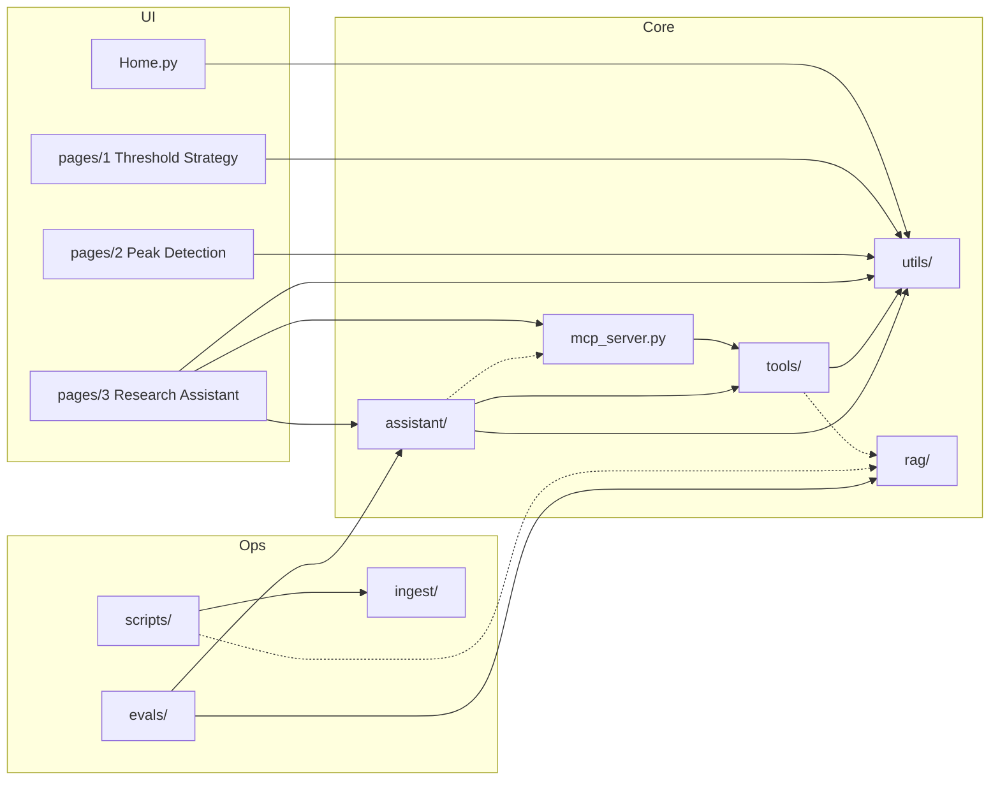

# Module Map

Per-module reference for the repository as it is today: responsibility, public
surface, internal dependencies, and the invariants each module carries. For the
end-to-end flows, see [system-overview.md](system-overview.md).

Line counts are approximate (`wc -l` at the time of writing) and only indicate size.

---

## Dependency graph

Internal imports only (third-party libraries listed per module below). Arrows point
from importer to imported. Dashed edges are lazy (function-level) imports.

Notes on the graph:

- `assistant/agent.py` imports `mcp_server.server` inside `ResearchAgent.__init__` when no server is passed; the page passes one explicitly (`shared_resources()`).
- `tools/core.search_fed_docs` imports `rag.get_index` inside the function.
- `scripts/daily_update.py` imports `rag.update_default_index` only when new FOMC documents were fetched; `scripts/build_fomc_index.py` imports `rag` at module level.
- `ingest/` has no internal dependencies outside itself; `rag/` likewise.
- `tests/test_import_footprint.py` guards that `Home.py`, page 1, and page 2 do not pull in the packages in its `HEAVY` list (including `anthropic`, `openai`, `mcp`, `fastembed`, `faiss`, `requests`, `bs4`).

---

## Entry points

| Entry point | Kind | Imports (internal) |
|---|---|---|
| `Home.py` | Streamlit main page | `utils`, `utils.analysis` |
| `pages/1_💠_Threshold_Strategy.py` (~380) | Streamlit page | `utils` |
| `pages/2_🏔️_Peak_Detection.py` (~240) | Streamlit page | `utils`, `utils.peak_detection` |
| `pages/3_🤖_Research_Assistant.py` (~360) | Streamlit page | `assistant`, `assistant.agent`, `mcp_server`, `utils`, `utils.sidebar`, `utils.strategy` |
| `mcp_server.py` (~65) | MCP server (stdio / `--http`) | `tools` |
| `scripts/daily_update.py` | CLI, run by the daily workflow | `scripts/update_market_data`, `scripts/fetch_fomc`, `rag` (lazy) |
| `scripts/update_market_data.py` | CLI (`--dry-run`, `--lookback-days`) | `ingest`, `ingest.market_update` |
| `scripts/fetch_fomc.py` (~305) | CLI (`--incremental`) | none (requests, bs4, pypdf) |
| `scripts/build_fomc_index.py` | CLI (`--incremental`) | `rag` |
| `scripts/push_data_update.py` | CLI, git rebase + push | none |
| `python -m evals.run` | Eval CLI | `evals.*`, `assistant.cache` |
| `.github/workflows/ci.yml` | CI | pytest, `evals.run ci`, optional live Anthropic job |
| `.github/workflows/daily-update.yml` | Scheduled job | `scripts/daily_update.py`, pytest, `scripts/push_data_update.py` |

---

## `utils/` — analytics core

Shared by the dashboard and (through `tools/`) by the MCP server and assistant.
`utils/__init__.py` re-exports most helpers, so importing any submodule also loads
`charts` (plotly) and `sidebar`/`data_loader`/`metrics` (streamlit).

| Module | Responsibility | Key symbols | Depends on |
|---|---|---|---|
| `strategy.py` (~55) | Single source of strategy parameters and the one-step rule. | `StrategyParams`, `DEFAULT_STRATEGY`, `SESSION_KEY`, `apply_rule_once` | — |
| `backtest.py` (~65) | Threshold backtest; signal-mask backtest; last-row transition. | `run_backtest`, `run_backtest_with_signals`, `latest_transition` | `strategy` |
| `data_loader.py` (~115) | CSV read, trading-session filter, gap fill, Panic Index, mtime cache key, Streamlit caches. | `CSV_PATH`, `read_market_data(as_of, fill_method)`, `compute_panic_index`, `data_version`, `load_data`, `load_filtered_data` | streamlit, pandas |
| `metrics.py` (~145) | Canonical return, drawdown, Sharpe, Calmar; KPI rendering. | `build_performance_metrics`, `max_drawdown`, `sharpe_ratio`, `RISK_FREE_RATE` | streamlit |
| `analysis.py` (~200) | Diagnostics, exposure trade-off attribution, verdicts, comparison tables, evidence summaries. | `build_strategy_diagnostics`, `build_exposure_tradeoff_attribution`, `build_backtest_verdict`, `build_strategy_comparison_table`, `build_correlation_evidence_summary` | `metrics` |
| `narrative.py` (~210) | Deterministic rule-based research summary (no LLM). | `build_threshold_research_summary` | `metrics` |
| `peak_detection.py` (~45) | Hindsight `scipy.find_peaks` labels; causal real-time reversal detector. | `detect_peaks_scipy`, `detect_peaks_realtime` | scipy |
| `signals.py` (~20) | Panic signal prep and threshold masks. | `prepare_panic_signal`, `build_threshold_masks` | — |
| `charts.py` (~275) | Plotly builders and Streamlit render helpers. | `render_scatter_plot`, `render_price_signal_map`, … | plotly, streamlit |
| `sidebar.py` (~175) | Sidebar navigation and controls; persists strategy settings in session state. | `add_sidebar_nav`, `render_controls`, `strategy_settings`, `render_sidebar_header` | `strategy`, streamlit |

Invariant carried: dashboard reads use full-sample VIX normalization and linear
interpolation (`load_data`) by design; the point-in-time path uses
`read_market_data(as_of=…, fill_method='ffill')` instead (AGENTS.md §4).

---

## `tools/` — point-in-time tool layer

| Module | Responsibility | Key symbols | Depends on |
|---|---|---|---|
| `market.py` (~90) | As-of truncated market frames; shared store keyed on CSV mtime; input errors surfaced to MCP clients. | `MarketStore.frame_as_of`, `get_store`, `set_store`, `MARKETS`, `ToolInputError`, `to_date` | `utils.data_loader`, `mcp` (ToolError) |
| `core.py` (~425) | The six research tools plus the deterministic fallback summary. | `get_regime`, `run_backtest`, `plan_position`, `get_forward_returns`, `detect_peaks`, `search_fed_docs`, `rule_based_summary`, `RESEARCH_TOOLS` | `utils.analysis`, `utils.backtest`, `utils.metrics`, `utils.narrative`, `utils.peak_detection`, `utils.strategy`, `rag` (lazy), pydantic |
| `schemas.py` (~165) | Pydantic result models (JSON schemas for MCP). | `RegimeResult`, `BacktestResult`, `PositionPlanResult`, `ForwardReturnsResult`, `PeaksResult`, `PeakEvent`, `HorizonStats`, `FedDocSearchResult`, `Market` | pydantic |

Invariants carried:
- Every tool takes `as_of`, reads nothing later, and returns `as_of` + `data_through` (AGENTS.md §4; `tests/test_point_in_time.py`).
- `plan_position` applies the rule once to a supplied position; it never replays history (AGENTS.md §3, §5; `tests/test_position_plan.py`).
- `run_backtest(initial_position_pct=…)` is the position at the start of the window, not today's (AGENTS.md §5).
- `get_forward_returns` counts only windows ending on or before `as_of`.

---

## `mcp_server.py`

Builds one `MCPServer("panic-index-research")`, registers each function in
`RESEARCH_TOOLS` with `ToolAnnotations(read_only_hint=True, idempotent_hint=True,
destructive_hint=False, open_world_hint=False)` and `structured_output=True`, and
exposes a module-level `server` that the assistant reuses in-process.
Configured for Claude Code via `.mcp.json` (`${PANIC_INDEX_PYTHON:-python} mcp_server.py`).
Tested by `tests/test_mcp_server.py`.

---

## `assistant/` — research agent

| Module | Responsibility | Key symbols | Depends on |
|---|---|---|---|
| `agent.py` (~750) | Tool-use loop over an in-process `mcp.Client`; system prompt; answer schema; as-of clamp; strategy-arg defaults; call-id labelling; repair turn; fallback; Anthropic and DeepSeek providers. | `ResearchAgent`, `DeepSeekAgent`, `AgentResult`, `ToolCall`, `SYSTEM_PROMPT`, `FINAL_ANSWER_SCHEMA`, `ANSWER_FIELDS`, `GuardrailViolation`, `_clamp_as_of`, `_apply_strategy`, `DEEPSEEK_BASE_URL` | `tools`, `tools.market`, `utils.strategy`, `mcp_server` (lazy), `.cache`, `.ledger`, `.presentation`, `.render`, `.signal`, `.validator`; anthropic, openai, mcp |
| `signal.py` (~165) | Standard backtest (fixed start 2021-05-17) → strategy path signal; comparison table plans. | `StrategySignal`, `build_strategy_signal`, `position_plans`, `STANDARD_BACKTEST_START`, `COMPARISON_POSITIONS` | `tools`, `utils.strategy` |
| `presentation.py` (~105) | Code-owned decision facts for page and model; cap/floor labelling. | `DecisionFacts`, `build_decision`, `boundary_state` | `tools`, `tools.schemas`, `utils.strategy`, `.signal` |
| `render.py` (~165) | Fills `{btN.*}` / `{ppN.*}` / signal placeholders with unit-formatted values; reports unknown placeholders. | `render`, `Rendered`, `CALL_FIELDS`, `PLAN_FIELDS`, `SIGNAL_PLACEHOLDERS` | — |
| `validator.py` (~105) | Machine-checkable contract: placeholder errors, raw position figures (one format rule), citation provenance and date. | `validate_answer`, `raw_position_figures`, `citation_violations` | `.render` |
| `cache.py` (~55) | Content-addressed response cache in `.cache/llm/`. | `ResponseCache`, `request_hash`, `CacheMiss`, `CACHE_DIR`, `MODES` | — |
| `ledger.py` (~165) | Usage log `logs/llm_usage.jsonl`, pricing, daily budget, `billed_to`. | `UsageLedger`, `PRICING`, `cost_usd`, `BudgetExceeded` | — |

Invariants carried: AGENTS.md §1 (code owns decision facts), §2 and *Validator rules*
(shallow validator), §3 (position from page input only), §5 (path vs user position),
*Placeholder policy*, and "one repair turn then fallback". Tests:
`test_agent.py`, `test_guardrails.py`, `test_position_plan.py`, `test_research_page.py`.

---

## `rag/` — FOMC retrieval

| Module | Responsibility | Key symbols | Depends on |
|---|---|---|---|
| `chunking.py` (~125) | Paragraph packing; per-exchange transcript splitting that keeps the question; embedding text; JSONL loading. | `split_text`, `split_transcript`, `chunk_documents`, `embedding_text`, `load_documents`, `MAX_CHARS`, `MIN_CHARS` | — |
| `index.py` (~225) | FAISS index with as-of ID-selector filtering; BM25 and hybrid RRF; month-aware third ranking; persistence; manifest-mtime reload. | `FedDocIndex` (`build`, `add_documents`, `save`, `load`, `eligible_ids`, `search`), `FastEmbedEmbedder`, `get_index`, `set_index`, `build_default_index`, `update_default_index`, `DOCUMENTS_PATH`, `INDEX_DIR` | `.chunking`, `.lexical`, `.query`; faiss, numpy, fastembed (lazy) |
| `lexical.py` (~60) | Tokenizer, BM25, reciprocal rank fusion. | `BM25`, `reciprocal_rank_fusion`, `tokenize` | numpy |
| `query.py` (~20) | Detects "Month YYYY" mentions for date-aware retrieval. | `month_mentions` | — |

Data: `data/fomc/documents.jsonl`; `data/fomc/index/{chunks.faiss, chunks.jsonl, manifest.json}`.
Invariant carried: documents filtered by `published_at <= as_of` **inside** the search
(AGENTS.md §4). Tests: `test_rag.py`, `test_retrieval_eval.py`, `test_fetch_fomc.py`.

---

## `ingest/` — market data ingestion

| Module | Responsibility | Key symbols | Depends on |
|---|---|---|---|
| `sources.py` (~150) | Yahoo chart API closes (adjusted for ETFs), CNN Fear & Greed history and live reading. | `fetch_all`, `fetch_yahoo_closes`, `fetch_cnn_fear_greed`, `apply_live_readings`, `SourceError` | `.trading_calendar`; requests, pandas |
| `market_update.py` (~340) | Append-only merge, chain-linking, completeness and quality checks, raw CSV I/O. | `merge`, `validate`, `read_raw`, `write_raw`, `last_settled_session`, `last_complete_date`, `UpdateReport`, `DataQualityError` | `.trading_calendar`; pandas |
| `trading_calendar.py` (~45) | NYSE holiday calendar incl. special closures. | `is_trading_day`, `NYSEHolidayCalendar` | pandas |

Invariant carried: the market CSV is append-only; stored values are never overwritten
(AGENTS.md *Data and secrets*). Tests: `test_ingest.py`.

---

## `scripts/`

| Script | Responsibility | Depends on |
|---|---|---|
| `daily_update.py` | Runs market update → incremental FOMC fetch → incremental index update; JSON summary. | `update_market_data`, `fetch_fomc`, `rag` |
| `update_market_data.py` | Fetch + merge + write `data/market_data_clean.csv`. | `ingest` |
| `fetch_fomc.py` | Scrape federalreserve.gov calendar; statements, minutes, press-conference PDFs; `published_at`. | requests, bs4, pypdf |
| `build_fomc_index.py` | Full or incremental index build. | `rag` |
| `push_data_update.py` | Rebase the data commit on latest `main` and push, ≤3 attempts, never force. | git |

Tests: `test_fetch_fomc.py`, `test_push_data_update.py`.

---

## `evals/`

| Module | Responsibility | Depends on |
|---|---|---|
| `run.py` (~300) | Unified CLI: `offline`, `ci`, `consistency`, `retrieval`, `agent`; `--live`/`--provider`/`--fresh`/`--judge`/`--yes`; confirmation and exit codes; `.env` loading for live only. | `evals.agent_eval`, `evals.consistency_eval`, `evals.retrieval_eval`, `evals.judge`, `assistant.cache` |
| `agent_eval.py` (~250) | End-to-end agent eval (replay / record / live): tool selection, decision correctness, citation precision, numeric faithfulness, leakage. | `assistant`, `assistant.cache`, `evals.judge`, `evals.metrics` |
| `consistency_eval.py` (~175) | Offline decision-scenario fixtures and contract probes; agent layer for live runs. | `assistant`, `evals.agent_eval`, `evals.judge` |
| `retrieval_eval.py` (~90) | recall@k, MRR, leakage; dense / bm25 / hybrid ablation. | `rag`, `evals.metrics` |
| `judge.py` (~130) | LLM groundedness labels (supported / unsupported / contradicted); measurement only. | `assistant.agent`, `assistant.ledger` |
| `metrics.py` (~135) | Number / date extraction, recall, reciprocal rank, leakage helpers. | — |
| `datasets/` | `agent.yaml` (15), `consistency.yaml` (10), `retrieval.yaml` (30). | — |
| `results/` | Committed result JSON from offline and DeepSeek runs. | — |

Tests: `test_eval_cli.py`, `test_eval_metrics.py`, `test_judge.py`, `test_agent_eval_replay.py` (skipped: no `evals/recordings/`).

---

## Invariant → module index

| AGENTS.md rule | Owning module(s) |
|---|---|
| §1 Code owns decision facts | `assistant/presentation.py`, `assistant/signal.py`, `tools/core.plan_position`, `utils/strategy.apply_rule_once` |
| §2 Shallow runtime validation | `assistant/validator.py`, `assistant/render.py` |
| §3 Position from UI state | `pages/3_🤖_Research_Assistant.py`, `assistant/agent.ResearchAgent.run`, `assistant/presentation.build_decision` |
| §4 Point-in-time | `tools/market.py`, `utils/data_loader.read_market_data`, `rag/index.eligible_ids`, `assistant/agent._clamp_as_of`, `assistant/validator.citation_violations`, `scripts/fetch_fomc.py` (`published_at`) |
| §5 Path vs user decision | `assistant/signal.py` (standard backtest), `tools/core.plan_position` |
| Placeholder policy | `assistant/render.py`, `assistant/agent.CALL_ID_PREFIXES` |
| Append-only data | `ingest/market_update.py` |
| Live-eval safety | `evals/run.py` |
| Import footprint | `utils/` (pages 0–2 import only this), `tests/test_import_footprint.py` |
